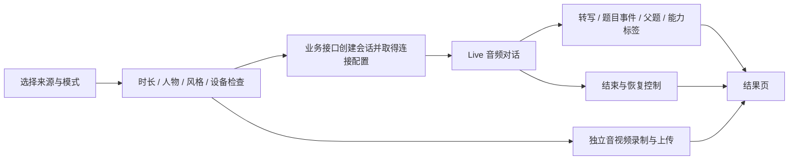
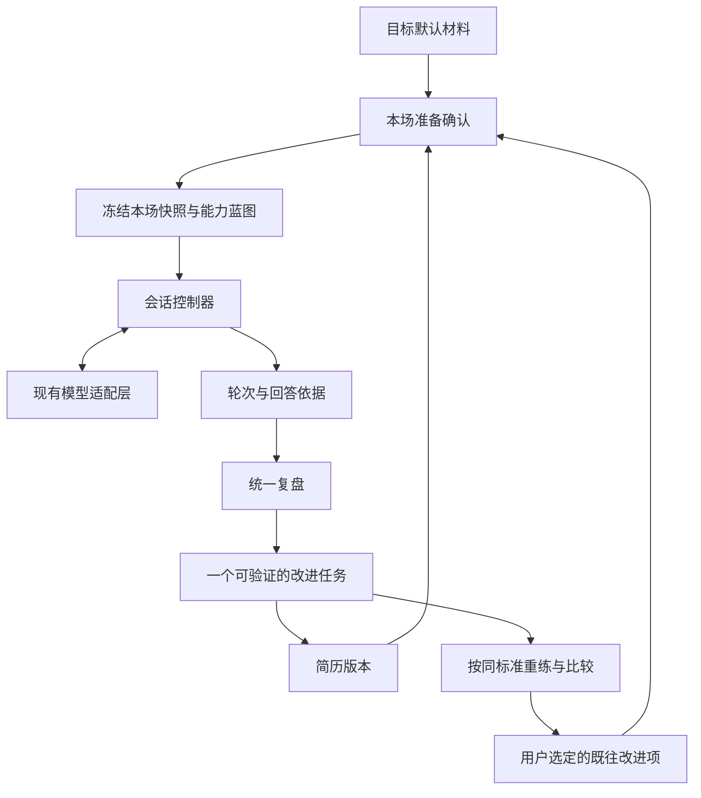

# 职面模拟面试：REA 二次拆解与业务流程改进方案

日期：2026-10-15。对照代码：`75839c6`。本轮交付为竞品分析、证据索引和实施设计；下文的“建议 / 待实施”不代表页面已经具备这些功能。

## 先给结论

继续沿用已经确定的主线：**目标岗位 → 简历确认 → 选择面试官 → 正式模拟 → 统一复盘 → 专项重练**。需要深化的是每一步之间的业务关联：本轮练什么、为什么追问、复盘依据是什么、重练是否补上缺口，以及下一场是否还要考察。

本轮最值得借鉴的三点：

1. **目标岗位拥有持续的准备记录。** 材料默认值、本场快照、历史会话、改进任务分开保存，再通过同一个目标关联。
2. **面试过程由明确规则推进。** 面试官身份、压力风格、考察目标是不同配置；模型提出追问建议，程序控制次数、重复、跳过、恢复与结束。
3. **复盘必须产生可验证的下一步。** 从原回答定位缺口，再带着相同标准重练；达到标准后才能说这次有改善。

建议优先级：**目标准备与材料确认 → 考察蓝图 → 会话推进 → 改进任务与重练验证**。可靠语音随后完善，录像和数字人再后置。

## 1. 这次实际怎样使用 REA

使用官方 npm 包 `rea-agents@6.5.0` 的 CLI，Node `24.12.0`，本机 Chrome `155.0.8059.79`。通过 CDP 检查页面，捕获公开脚本，再运行静态应用分析和浏览器场景。没有更改职面运行代码，也没有配置持久 MCP 或安装原生反编译器。

证据分为三个等级，文中分别标注：

- **运行观察**：浏览器实际到达的页面、一次公开交互的结果。
- **前端静态证据**：公开脚本中的路由、调用定义、字段与分支；证明代码路径存在，不证明当前账号能用或后端已成功执行。
- **官方说明**：厂商帮助文档所述流程；没有冒充登录后的独立验收。

| 样本 | 实际取得的证据 | 没有取得的证据 |
|---|---|---|
| Huru | REA 页面检查、脚本导出、bundle 分析、静态应用图；公开页切换岗位导入说明；直接访问连续面试准备页会回到登录页 | 登录后完整面试、实时模型实际表现、付费权益、后台源码 |
| Yoodli | REA bundle 分析与脚本导出；标准 Chrome UA 下确认 Google / Microsoft / 邮箱登录入口；检查场景、人物、评价目标及数字人调用定义 | Builder 保存结果、真实练习、视频连接与评价质量 |
| Final Round AI | 旧网页入口跳转官网；REA 捕获当前练习文档；核验目标、报告、记忆和视频窗口官方说明 | 桌面客户端运行、登录会话、原生二进制和后端实现 |

Yoodli 默认 headless UA 曾显示兼容性提示；另开标准 Chrome UA 的独立上下文后到达登录页，并由 REA 再次捕获。没有绕过登录。Huru 两个场景动作完成，但 REA 标记事件覆盖不完整；不据此断言不存在其他请求。

Huru 应用图读取两个文件、约 395 万字节，解析失败为零；**语义图达到每文件 20,000 节点上限，覆盖为 partial**。没有声称恢复完整调用图。前端分析没有执行抓取的 JavaScript 文件，正常浏览网页自身加载脚本除外。

完整索引见 [evidence.json](./rea/2026-10-15/evidence.json)。它是筛选后的研究清单，保留 REA Evidence ID、原始结果 SHA-256、公开脚本摘要、定位锚点和限制，**不是完整原始 Evidence 包**。不在仓库分发第三方完整脚本、页面全文或大型语义图。

工具契约：[REA 官网](https://rea.tools/)、[CDP 观察说明](https://github.com/morluto/rea/blob/main/docs/browser-observation.md)、[脚本导出说明](https://github.com/morluto/rea/blob/main/docs/website-script-export.md)。复核步骤见 [取证与复核说明](./rea/2026-10-15/README.md)。

## 2. Huru：从单题录制升级成有状态的连续面试

### 2.1 先区分练习模式，再继承相同来源

**前端静态证据 H01–H02。** 题库、自定义题目等入口会根据模式，进入逐题面试或连续面试准备；连续模式有独立 setup / 会话 / results 路由。来源和已有问题随导航传入。不是每一种练习都被塞进同一套交互。

**对职面的判断。** 当前正式模拟与专项练习分开是合适的。继续共享岗位和材料，但不要让用户每次专项重答都重新完成整场准备，也不要在正式模式中默认展示参考答案。

### 2.2 面试官身份与提问风格分别配置

**前端静态证据 H04–H06。** 配置包含面试官 persona、压力等级、计划时长、语言、种子问题、音频 / 视频录制种类。脚本中三位人物分别配置名字、职位和声音；压力另有三个等级。时长与主问题目标数也有映射，但服务端是否使用同一映射未验证。

**对职面的判断。** HR / 业务面应决定“考察什么”，风格决定“怎样追问”，头像与声音决定“如何呈现”。第一版保留 HR / 业务两个主选择，先补明确的考察标准；风格先用默认值，避免用户开练前面对一大张配置表。

### 2.3 真正的工作量在会话控制

**前端静态证据 H07–H12、H18。** 已追到业务层的 Live SDK 调用，并非只搜索到依赖名字。其前端路径包含读取可用策略、设备准备、获取会话与连接配置、发送 PCM 音频、处理转写与模型音频、记录题目事件、恢复连接、结束控制。题目事件携带父题与能力标签；录制走独立的 `MediaRecorder` 路径。

据这些代码可以画出下列**前端职责图**。它不是厂商完整后台架构：

**能确认到的技术层。** 公开脚本存在 Google GenAI Live 的业务连接调用与音频输入、恢复句柄配置。未运行受保护的真实连接，因此模型版本、令牌有效期、当前可用性、后台提示词及评分服务仍未知。不能由 SDK 名称推断所有业务都使用同一个模型。

**不要直接照搬的点。** 结束分支会结合时间条件决定是否接受模型结束请求。这个机制说明“结束”需要程序约束，但职面不应为了凑满时长强行继续提问。用户明确不会、想跳过或主动结束，应给自然出口。

### 2.4 录制、分析、练习进度各有状态

**前端静态证据 H03、H13–H19。** 录像失败时结果页存在音频回退分支；报告有重新处理入口；视频提交失败保留本地重试线索。准备会话关联练习主题、推荐顺序和进度分析，另有反馈同步动作。接口定义不能证明后台同步一定可靠。

**对职面的判断。** 当前回答自动保存、失败后继续生成剩余点评已经有基础。下一步要让“回答已保存”“点评尚未完成”“材料还缺事实”“重练已通过”成为不同状态。分析失败不能让用户误以为回答没了，重练次数也不能直接当作能力提升。

原始资源：[Huru 应用入口](https://appv2.huru.ai/)、[本次公开 bundle](https://appv2.huru.ai/assets/index-DxR_0fPz.js)。定位与摘要见证据清单 H01–H19。

## 3. Yoodli：把场景、对话对象与评价标准拆开

### 3.1 这是前端结构证据，不只有产品概念

**前端静态证据 Y01–Y04、Y07–Y08。** 场景、人物、默认评价目标分别有调用定义；人物表单分别保存职位、公司、性格、背景、附加指令、声音与图片。组织侧代码另有评价目标权重的引用。

官方 Builder 文档也区分场景和人物，并提供文字预览、评价目标预览及不同结束方式。[Yoodli Builder](https://support.yoodli.ai/en/articles/10055659-builder)

**对职面的判断。** 我们不必建设通用角色扮演编辑器，但应在内部采用类似分离：

| 业务配置 | 职面中的含义 | 不应承担的职责 |
|---|---|---|
| 面试场景 | HR 初面 / 业务面，目标职级与本轮重点 | 不能只是一段标题 |
| 面试官策略 | 语气、追问方式、次数、停止规则 | 不决定候选人是否已掌握某项技能 |
| 能力标准 | 要考察的能力、需要的回答证据、达标条件 | 不随着面试官头像改变 |
| 本场材料 | 确认后的 JD、简历、已选改进项 | 不能被网页里的指令覆盖 |

### 3.2 练习记录可成为下一次练习的输入

**前端静态证据 Y03。** 后续练习准备调用使用 `coach_speech_id` 关联已有记录。可以确认存在“基于已有记录准备后续内容”的前端入口；具体筛选哪些薄弱点、是否自动执行、组织是否启用，尚未验证。

**对职面的判断。** 给改进任务保存明确的来源会话和回答，下一次开练可选“继续验证这项能力”。不要把上一场所有评语直接拼进提示词，更不要让某次误评永久成为对用户的判断。

### 3.3 数字人有单独的生命周期

**前端静态证据 Y05–Y06。** 预加载数字人调用带人物和语言，返回 ID / URL；有单独释放与关联练习的动作，关联字段明确使用 `tavus_conversation_id`。

这比上一轮“不能确认供应商”的判断多了一条可定位证据：**Yoodli 本次公开前端存在 Tavus 集成路径**。仍不能断言每个用户、每种练习、当前后台都使用 Tavus，也不能把这个发现套用到 Final Round。

**对职面的判断。** 数字人作为可替换的展示适配层。人物视频加载失败仍应保留同一场面试、题目和回答；用户摄像头预览、回答录制、AI 头像视频、视觉分析分别设计。

原始资源：[本次 main bundle](https://app.yoodli.ai/static/js/main.c3ac7c87.js)、[本次组织功能 bundle](https://app.yoodli.ai/static/js/orgs.1d3740d3.js)。定位与摘要见 Y01–Y08。

## 4. Final Round AI：目标贯穿流程，但报告重练衔接有边界

以下均为**官方说明**，未通过桌面客户端登录实测。

- 练习从目标启动；本轮准备界面确认材料和场景。目标默认值与仅本场覆盖分开，开始时冻结快照。[启动练习](https://docs.finalroundai.com/docs/mock-interviews/starting-a-mock)、[目标工作区](https://docs.finalroundai.com/docs/goals/goal-workspace)
- 视频窗口区分说话、聆听、思考与重连；用户摄像头只作私人预览，数字人视频不可用时可继续练习。[视频窗口](https://docs.finalroundai.com/docs/mock-interviews/mock-video-window)
- 报告优先给结论和下一步，逐题依据可展开；内容不足时显示不足，不强行给结论。生成失败、无足够内容、生成中是不同状态。[报告说明](https://docs.finalroundai.com/docs/session-reports/reading-your-report)、[报告状态](https://docs.finalroundai.com/docs/session-reports/finding-your-debrief)
- 跨场记忆来自已提交的反思，带来源并可删除；它与原始会话、报告分开保存。[记忆说明](https://docs.finalroundai.com/docs/privacy-and-memory/what-the-ai-remembers)

**需要修正上一轮的抽象。** 报告页“继续练习”会打开本目标的准备流程，**不会直接将该报告薄弱点预装进新练习**。目标已提交的记忆可能影响练习，但不等于点击按钮就自动指定了本次训练重点。[原文所在段落](https://docs.finalroundai.com/docs/session-reports/reading-your-report#practice-after-a-debrief)

**对职面的判断。** 保留我们已经实现的“从具体回答进入专项重练”。增加用户可选择的改进项和验证标准，完成后再更新目标的训练记录。总览只显示当前目标、继续入口和一个优先任务，完整准备与复盘仍在模拟面试内部。

## 5. 与职面现有代码逐项对照

| 环节 | `75839c6` 已有 | 本轮发现的缺口 | 建议结果 |
|---|---|---|---|
| 目标岗位 | 可关联岗位及快照；支持直接粘贴 JD | 准备配置是一个浏览器键，尚无每目标准备上下文；首页薄弱点取最近正式记录，没有按当前目标筛选 | 换岗位时材料、最近报告和优先任务同时切换 |
| 简历确认 | 可带入当前采用文本，确认后以正文快照开练 | 未关联简历版本 ID 与材料来源层级；不能明确区分岗位默认与仅本场替换 | 开练前看到“用哪份材料、来自哪里、本场是否替换” |
| 面试官 | HR / 业务两个策略，已版本化 | 区分了角色方向，但仍共用四维通用评分；题目缺少稳定能力 ID | 角色对应固定能力标准，前后练习按同一标准比较 |
| 正式模拟 | 固定开场 + 5 主问题 + 反问；每主问题最多两次追问 | `interview-turn` 只接收当前题及其追问，不带其他题已覆盖的事实与能力；不能稳定避免跨题重复 | 当前题追问结合全场覆盖摘要，必要时换能力点 |
| 统一复盘 | 只评价已答内容、原话校验、失败可继续 | 优先任务由缺口字符串去重后截前三条，没有能力层级归并和明确的达标条件 | 一条主任务，附依据、动作、达标条件；其余折叠 |
| 专项重练 | 保存原正式报告；记录来源回答；有前后重答 | 尚无任务状态及“补上 / 未补上 / 无法判断”的验证结果；下一场没有选择携带这些结果的契约 | 从缺口生成任务，重练验证后再决定是否进入新场景 |

代码定位：`formal-interview.js` 的 `saveSetup / refreshHome / start / submit / reportHtml / practice`；`ai-service.js` 的 `interview-plan / interview-turn / interview`；`interview-policy.js` 的角色策略和记录校验。简历已保存版本位于 `app.html`，本场目前仅携带正文快照。

特别值得修正的是**目标范围**：用户在 A 岗位发现的缺口，不应不加说明地成为 B 岗位首页的“上次优先改进”。这应在关联模型确定后处理，而非仅改卡片文案。

## 6. 细化后的用户业务流程

### 初次进入：明天有一场具体面试

选择 / 新建目标岗位 → 核对 JD 和相关简历 → 选择 HR 或业务面 → 看到本轮考察范围与预计时长 → 确认材料 → 开始。

只要求开始所必需的信息；没有简历时允许仅按 JD 练习，并说明个性化有限。正式开始前展示能力范围，不提前泄露具体问题。首次没有历史记录时不展示虚构薄弱点或准备度。

### 面试进行中：听不懂、不会答、网络出错

明确显示轮到谁、当前问题和保存状态。提供“重复问题 / 澄清题意 / 不会，换下一题 / 暂停 / 结束”。澄清与重复不计入两次实质追问；不会回答是训练状态，传输失败是技术状态，分开处理。

追问先补与岗位有关的重要证据，已有充分依据则前进；不反复索取用户没有的数字，不连续重复同一个事实。模型请求失败保留当前轮次，重试使用同一回答 ID，避免重复提问和重复记分。

### 面试结束：五分钟内知道先改什么

回答先持久保存 → 展示报告生成状态 → 一句话结论 → 一个最优先改进项 → 原回答依据 → 达标条件 → 进入专项重练。其余问题按需展开。回答不足与生成错误分开显示，未回答不按零分处理。

### 重练：验证改善，随后迁移到新题

进入时带上原问题、原回答、评价标准和缺口；先让用户补事实，再独立重答。对照同一标准判断缺口是否补齐，展示新增了什么证据。若已补齐，推荐一个同能力的新问题验证迁移；仍不足则给一个更小的练习动作。

简历中的事实缺失可进入简历助手的对应段落，补充后由用户采用。旧报告仍引用旧快照，新版本只影响下一场。不能自动把点评意见写成用户做过的经历。

### 再次进入：换岗位或继续同一岗位

同一目标显示上次未完成的主任务；用户选择是否作为本场重点，最多带少量有依据的项目。切换目标时重新确认材料与考察范围。不要直接继承其他岗位的全部评价。

这些细化属于**职面的实施建议**，不是声称三家竞品已经全部采用相同规则。

## 7. 建议的业务对象与程序边界

| 对象 | 最小内容 | 核心规则 |
|---|---|---|
| `GoalContext` | 稳定目标 ID、可选 `jobId`、JD、默认简历版本、本轮方向 | 手动 JD 也有目标 ID，不能靠公司名去重 |
| `RunSnapshot` | 材料正文 / 来源 / 版本、角色策略版本、能力标准版本、用户选定重点 | 开始后冻结，材料变化不改旧记录 |
| `Turn` | 稳定轮次 ID、父题、能力 ID、问题、回答、来源引用、状态 | 重复请求幂等；已覆盖事实可跨题引用 |
| `Debrief` | 分析状态、按能力汇总的依据、主任务、未覆盖项 | 区分不足 / 失败 / 未测，避免伪精确判断 |
| `PracticeTask` | 来源会话 / 回答、缺口、达标条件、尝试记录、验证结果 | 原报告不可被重练覆盖；不因重练一次就标记掌握 |

建议 `PracticeTask` 状态：`suggested → selected → practicing → verified / needs_more / unknown`。删除一条未来重点不删除原会话。评价版本或材料范围不同的结果不能直接算作同条件涨分。

这是建议架构，不是已有代码。优先扩展当前角色策略、AI 契约和来源关系；无需先引入多 Agent 框架或更换模型。语音、录像、数字人通过独立适配层接入同一会话控制器。

当前除真实面试复盘外，多数训练材料仍在账号作用域的浏览器存储；研究中的目标对象不代表跨设备同步已经存在。若迁移至服务端，应以账号所有权校验、事务和可恢复分析任务为边界，保留 v2 记录读取及导入能力。不要用一个新字段假装已经完成迁移。

## 8. 可直接进入开发的优先顺序与验收

下面的价值与成本为基于当前代码的工程判断，不是竞品实测转化数据。

| 顺序 | 改进包 | 用户可见结果 | 依赖与验收 |
|---|---|---|---|
| 1 / P0 | 目标准备与材料确认 | 模拟面试顶部一个当前目标卡，显示所用简历与本场覆盖；总览只保留继续入口 | 准备信息按目标保存；A / B 切换不会串材料和任务；旧报告不变；无简历仍能开练 |
| 2 / P0 | 考察蓝图与标准 | 开练前知道本轮重点；HR / 业务有实际评价区别 | 题目带稳定能力 ID；标准独立于措辞；同题重答沿用同版标准；不提前展示题目答案 |
| 3 / P0 | 面试推进与恢复 | 自然澄清、不会换题、避免跨题重复；出错后继续同一场 | 给模型有限的全场覆盖摘要；保持每题最多两次实质追问；回答 ID 幂等；重试 / 刷新不产生重复轮次 |
| 4 / P0 | 改进任务与重练验证 | 报告直接告诉用户先补什么，重答后知道补上没有 | 主任务可定位原话；达标条件可检查；保留父报告；证据不足显示无法判断；新场次只带用户选择的重点 |
| 5 / P1 | 可靠语音体验 | 开始前设备试说，过程中显示说话状态与转写确认，停顿和失败可恢复 | 区分权限拒绝 / 无设备 / 识别不可用 / 网络问题；停止录音不等于结束整场；转写未确认不误提交 |
| 6 / P2 | 可选录像与数字人 | 先回答回放，后面试官形象；视频加载不阻断练习 | 先验证录制、回看和保存，再接头像供应商；纯音频 / 文字可继续；媒体失败不丢文字回答 |

第 1 包应先确定目标和快照数据契约；第 2 包给第 3、4 包提供共同能力标准，随后才有可信的重练比较。第 5 包可以复用已稳定的文本会话规则，第 6 包复用其生命周期。

第一轮开发完成时，至少走完这些业务场景：

1. 新用户仅有 JD，也能完成模拟并查看有内容依据的复盘。
2. 同一用户切换两个岗位，只看到各自材料、记录和改进任务。
3. 一道题回答完整时前进；用户不会时不持续逼问；澄清不消耗实质追问次数。
4. 已在上一道题解释过的事实不会被无意义地再问一次。
5. 点评生成失败可继续，已完成结果保留，未测项不补零。
6. 从报告进入专项重练，原会话完整保留；“补上缺口”有新回答依据。
7. 简历助手采用新版本后，下一场可用新材料，上一场仍能复核旧快照。
8. 关闭页面再回来恢复同一任务；旧 v2 备份仍可读取，损坏数据不被覆盖。

## 9. 这轮不建议顺手扩展的方向

不引入通用人格编辑器、十几种面试类型或多 Agent 编排。笔试继续后置。外观上的数字人不代替追问逻辑和证据复盘；不同模型的速度和价格也不是本轮取证能得出的结论。

最适合职面近期形成完整体验的切入点，是围绕一个具体岗位完成一次真实准备，经历一场会追问、可恢复的模拟，再看见自己针对同一缺口的改进证据。
